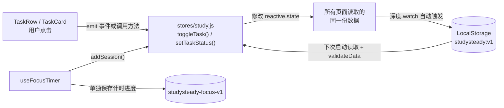

# StudySteady

StudySteady 是一个面向大学生的**本地学习工作台**：把学习目标拆成项目与任务，安排到日历，用专注计时记录投入，再通过统计回顾进展。它不需要账号、后端或数据库，所有数据都保存在浏览器本地。

这个项目同时也是一份可以运行的前端学习材料：用 Vue 3 完成一个多页面应用，覆盖组件拆分、路由、状态管理、本地持久化、表单校验、可访问性与响应式布局。

**技术栈**：Vue 3（Composition API + `<script setup>`）· Vue Router 4 · Vite 7 · Lucide 图标 · 原生 SVG / CSS 图表

## 先跑起来

环境要求：Node.js **22.12.0 或更新版本**，可用 `node -v` 检查。

```sh
npm install
npm run dev
```

打开终端输出的地址（默认 `http://localhost:5173`）。首次打开会载入演示数据：4 个项目、24 个任务和若干专注记录，日期都相对当天生成，所以马上就能看到“今天”的安排。

其他常用命令：

| 命令            | 作用                                       |
| --------------- | ------------------------------------------ |
| `npm run dev`     | 启动开发服务器，修改代码后自动刷新       |
| `npm run build`   | 构建到 `dist/`，提前发现打包问题         |
| `npm run preview` | 在本地预览构建结果，检查生产版本的表现   |

## 建议的学习路线

不要从头到尾顺序阅读，按“先体验、再追踪、最后修改”的方式更有效：

1. **先玩一遍**：把五个页面各操作几分钟（见下方导览），知道产品在解决什么问题。
2. **看骨架**：`src/main.js` → `src/router/index.js` → `src/App.vue`，理解应用如何启动、页面如何切换、全局布局和弹窗挂在哪一层。
3. **看数据**：`src/stores/study.js` 是整个项目的核心。先弄清 `state` 里有什么，再逐个看方法负责什么。
4. **纵向追踪一条链路**：推荐“新建任务”：`TaskEditor.vue` 提交表单 → `saveTask()` 校验并写入 `state` → `watch` 自动保存到 LocalStorage → 总览、日历、统计同时更新。再用同样的方法追“切换主题”“完成一次专注”“导入备份”。
5. **动手改**：从改文案、改样式开始，按“动手练习”逐步添加一个小功能。

## 页面导览

| 路径         | 页面       | 可以做什么                                                     | 主要文件                                                   |
| ------------ | ---------- | -------------------------------------------------------------- | ---------------------------------------------------------- |
| `/`          | 学习总览   | 查看今日清单与本周日期、项目进度、近期安排、逾期任务，开始专注 | [DashboardView.vue](src/views/DashboardView.vue)           |
| `/projects`  | 项目与任务 | 项目和任务的增删改查、搜索筛选、排序、列表/看板视图切换        | [ProjectsView.vue](src/views/ProjectsView.vue)             |
| `/calendar`  | 学习日历   | 切换月份、按天查看任务、为某天新建任务、修改任务截止日期       | [CalendarView.vue](src/views/CalendarView.vue)             |
| `/analytics` | 学习统计   | 切换 7/30 天周期，查看专注柱图、完成率、活动热图、项目进度     | [AnalyticsView.vue](src/views/AnalyticsView.vue)            |
| `/settings`  | 偏好设置   | 修改昵称与学习目标、设置专注时长、切换主题、备份恢复与清空数据 | [SettingsView.vue](src/views/SettingsView.vue)              |
| 其他任意地址 | 404 页面   | 提示页面不存在，并提供返回入口                                 | [NotFoundView.vue](src/views/NotFoundView.vue)              |

几个值得体验的交互：

- 在总览页点击周条上的日期，清单会切换成那一天的安排。
- 在项目页把视图切成“看板”，可以直接拖动任务卡，或使用卡片底部的状态选择器。
- 打开任意弹窗后，可以用 `Tab` 在弹窗内循环焦点，按 `Esc` 关闭。
- 在设置页把主题切成“夜间”，再刷新页面，主题依然保留。

## 目录结构

```text
src/
  main.js                 创建 Vue 应用，注册路由与全局样式
  App.vue                 应用外壳：侧栏、顶栏、路由出口、主题应用、全局弹窗
  router/index.js         路由表，页面组件按需动态加载
  stores/study.js         唯一数据源：业务数据、操作方法、LocalStorage 持久化与导入校验
  composables/
    useFocusTimer.js      全应用共享的专注计时器，支持刷新恢复
  data/demo.js            相对当天生成的演示数据
  utils/date.js           按本地日历处理 YYYY-MM-DD 的日期工具
  views/                  5 个主页面与 404 页面
  components/
    layout/               侧栏与顶栏
    dashboard/            周日期条、专注计时面板
    projects/             项目卡片、项目编辑弹窗
    tasks/                任务行、任务卡、看板、筛选器、任务编辑弹窗
    calendar/             月历网格
    analytics/            柱状图、完成率环、活动热图
    settings/             主题选择器
    ui/                   弹窗、确认框、空状态、页头、进度条、统计卡、提示条
  assets/styles.css       设计变量、布局与全部响应式样式
tests/                    数据层与关键流程的测试样例，可对照阅读
scripts/                  辅助脚本
```

## 一次点击发生了什么

以“完成一个任务”为例，数据只会朝一个方向流动：



理解这条链路后，项目里大部分功能都能顺着找到位置：**视图负责展示和交互，store 负责数据和规则，LocalStorage 负责长期保存。**

## 核心设计：一个 store 管理所有数据

[study.js](src/stores/study.js) 是一个模块级单例。任何页面调用 `useStudyStore()` 拿到的都是同一份 `state`，所以修改会立即反映到所有视图，不需要额外的跨组件传值。

- `state` 保存 `projects`、`tasks`、`sessions` 和 `settings`，是唯一的数据来源。
- `ui` 保存弹窗、提示、确认框等临时界面状态，不写入本地存储。
- 深度 `watch` 监听 `state`，每次修改后自动保存；整体替换数据时用 `replacing` 标记暂缓保存，避免写入中间状态。
- 所有写操作都经过 store 的方法校验，例如 `saveTask()` 会检查标题、状态、截止日期、项目关联和预计时长。
- `validateData()` 在导入前检查字段格式、编号唯一性和关联关系，校验通过才替换现有数据，避免坏备份破坏学习记录。
- `ui.dataRevision` 在导入或清空数据后自增，用来通知计时器重置，防止旧计时结果写进新数据。

常用方法可以按用途分组阅读：

| 用途       | 方法                                                        |
| ---------- | ----------------------------------------------------------- |
| 任务       | `saveTask`、`deleteTask`、`toggleTask`、`setTaskStatus`     |
| 项目       | `saveProject`、`deleteProject`、`projectProgress`           |
| 专注记录   | `addSession`                                                |
| 界面与提示 | `openTask`、`openProject`、`notify`、`confirmAction`        |
| 数据管理   | `exportData`、`importData`、`resetDemo`、`clearData`        |

## 专注计时器如何跨页面工作

[useFocusTimer.js](src/composables/useFocusTimer.js) 演示了“把有状态逻辑抽成组合式函数”的写法：

- 计时不依赖 `setInterval` 的累加，而是记录一个**截止时间戳**，每次根据当前时间计算剩余秒数，所以后台标签页变慢也不会走偏。
- 计时器在 `App.vue` 中初始化一次，切换页面不会重建，专注不会中断。
- 进度单独保存在 `studysteady-focus-v1`，刷新或重新打开页面后可以继续。
- 结束专注时先写入记录再重置，并复用同一个记录编号，数据层按编号去重，避免重复累计。
- 页面关闭期间如果修改过专注时长，空闲或暂停中的计时会重置为新时长；运行中的计时不受影响。

## 数据模型

所有日期都是本地日历的 `YYYY-MM-DD` 字符串，时间戳使用 ISO 字符串。

| 数据     | 主要字段                                                                                       |
| -------- | ---------------------------------------------------------------------------------------------- |
| 项目     | `id`、`name`、`description`、`color`、`icon`、`category`、`dueDate`、`createdAt`                |
| 任务     | `id`、`title`、`description`、`projectId`、`dueDate`、`priority`、`status`、`estimatedMinutes`、`createdAt`、`completedAt` |
| 专注记录 | `id`、`date`、`minutes`、`taskId`                                                               |
| 设置     | `name`、`dailyGoal`、`focusMinutes`、`theme`                                                    |

固定的取值范围：

- `status`：`todo`（待开始）、`in-progress`（进行中）、`done`（已完成）
- `priority`：`high`、`medium`、`low`
- `theme`：`light`、`dark`、`system`

“逾期”不是存储状态，而是根据 `dueDate < today` 且任务未完成动态判断出来的；“今日完成”按 `completedAt` 统计，所以可能包含截止日期不在今天的任务。这类口径差异在 [ProjectsView.vue](src/views/ProjectsView.vue)、[DashboardView.vue](src/views/DashboardView.vue) 和 [AnalyticsView.vue](src/views/AnalyticsView.vue) 中都有注释说明。

## 跟着项目学 Vue

| 主题                 | 建议阅读                                                                                       | 观察点                                                     |
| -------------------- | ---------------------------------------------------------------------------------------------- | ---------------------------------------------------------- |
| 声明式渲染与列表     | [TaskRow.vue](src/components/tasks/TaskRow.vue)、[TaskBoard.vue](src/components/tasks/TaskBoard.vue) | 数据变化如何直接反映到界面；`v-for` 为什么需要稳定的 `key` |
| 响应式状态           | [study.js](src/stores/study.js)                                                                 | `reactive` 与 `ref` 的分工；模块级单例如何被所有页面共享   |
| 计算属性             | [AnalyticsView.vue](src/views/AnalyticsView.vue)、[ProjectsView.vue](src/views/ProjectsView.vue) | 组合筛选、周期统计都由原始数据推导，不额外保存结果         |
| 组件通信             | [TaskFilters.vue](src/components/tasks/TaskFilters.vue)、[ThemePicker.vue](src/components/settings/ThemePicker.vue) | `props` + `emit` 实现 `v-model`；父组件持有状态            |
| 表单与校验           | [TaskEditor.vue](src/components/tasks/TaskEditor.vue)、[ProjectEditor.vue](src/components/projects/ProjectEditor.vue) | 编辑副本、提交时校验、失败时把错误显示在表单里             |
| 生命周期与 DOM       | [BaseModal.vue](src/components/ui/BaseModal.vue)                                                | 挂载时锁定背景与监听键盘，卸载时恢复焦点和滚动             |
| 侦听器               | [App.vue](src/App.vue)、[study.js](src/stores/study.js)                                         | 主题变化、数据变化分别触发什么副作用                       |
| 路由                 | [router/index.js](src/router/index.js)、[ProjectsView.vue](src/views/ProjectsView.vue)          | 动态导入拆分页面；筛选条件与 URL 查询参数双向同步          |
| 组合式函数           | [useFocusTimer.js](src/composables/useFocusTimer.js)                                            | 如何把计时、持久化、恢复封装成可测试的独立模块             |
| 可访问性             | [BaseModal.vue](src/components/ui/BaseModal.vue)、[App.vue](src/App.vue)                        | 跳过导航链接、焦点循环、`aria-*` 属性、`prefers-reduced-motion` |
| 响应式布局           | [styles.css](src/assets/styles.css)                                                             | 设计变量如何支持深色主题；断点如何逐级收起侧栏和网格       |

## 动手练习

由易到难，每个练习都会碰到不同的知识点：

1. **改界面文案与配色**：修改某个页面的标题，或在 [styles.css](src/assets/styles.css) 的 `:root` 中调整 `--green`，观察所有引用变量的地方一起变化。
2. **给任务加“标签”字段**：沿着“数据模型 → `saveTask` 校验 → `TaskEditor` 表单 → `TaskRow` 展示”的链路改一遍，体会一次完整的数据流。
3. **新增一个页面**：例如 `/review` 每周复盘页。需要在 `router/index.js` 注册路由、在侧栏加入口，并从 store 读取数据。
4. **抽取一个组合式函数**：把项目页的筛选逻辑移到 `src/composables/` 下，比较抽取前后的可读性。
5. **改进一个交互**：例如给看板增加键盘移动任务的能力，或为图表补充文字说明，练习可访问性设计。

改完之后刷新页面，检查数据是否仍能保存、其他页面是否同步更新——这比只看代码更能理解响应式系统。

## 数据保存在哪里

| 键                     | 内容                                   |
| ---------------------- | -------------------------------------- |
| `studysteady:v1`       | 项目、任务、专注记录与设置             |
| `studysteady-focus-v1` | 当前专注计时的进度、截止时间与关联任务 |

数据属于**当前浏览器与当前网站地址**，不会自动跨设备同步。本地预览和正式域名、不同浏览器之间各自保存一份数据。换设备或清理浏览器前，请先在设置页导出 JSON，再在目标设备导入；导入会先校验结构并要求确认。

如果本地数据损坏或存储不可用，应用会载入演示数据并给出提示，不会立刻覆盖原数据，此时可以先导出备份再处理。

## 常见问题

**刷新后数据还在吗？**
在。业务数据修改后会自动写入 LocalStorage，专注计时也会恢复到上次状态。

**为什么日期有时会差一天？**
项目统一使用本地日历的 `YYYY-MM-DD`。[date.js](src/utils/date.js) 把纯日期按本地中午解析，避免 `new Date("2026-10-25")` 按 UTC 午夜解析后在 UTC 以西的时区显示成前一天。

**专注计时暂停后关掉页面，会丢失吗？**
不会。暂停状态和剩余时间都会保存，下次打开继续。只有点击重置或更改专注时长才会清空。

**端口被占用怎么办？**
可以换一个端口：`npm run dev -- --port 5174`。

**数据会被上传吗？**
不会。项目没有后端，学习数据只写入浏览器本地存储。页面字体会从 Google Fonts 加载，网络不可用时自动退回系统字体，不影响使用。

## 延伸阅读

- [DESIGN_NOTES.md](DESIGN_NOTES.md)：产品取舍、视觉与交互思路
- [VUE_COVERAGE.md](VUE_COVERAGE.md)：Vue 知识点与对应代码位置的索引
